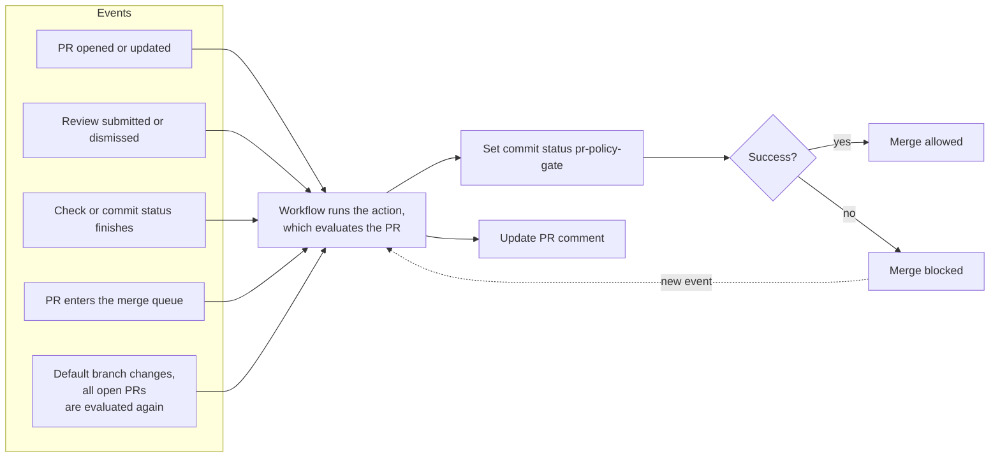

# PR Policy Gate

A GitHub Action that makes sure a pull request has the right approvals and passing checks before it can be merged.

## Why not GitHub's native features?

GitHub covers simple cases natively via rulesets.
The rule [`pull_request`](https://docs.github.com/en/enterprise-cloud@latest/repositories/configuring-branches-and-merges-in-your-repository/managing-rulesets/available-rules-for-rulesets#require-a-pull-request-before-merging) can require a number of approvals, and two of its settings can tie approvals to the changed files: [`require_code_owner_review`](https://docs.github.com/en/enterprise-cloud@latest/repositories/configuring-branches-and-merges-in-your-repository/managing-rulesets/available-rules-for-rulesets#require-a-pull-request-before-merging) for the owners that [CODEOWNERS](https://docs.github.com/en/enterprise-cloud@latest/repositories/managing-your-repositorys-settings-and-features/customizing-your-repository/about-code-owners) lists, and [`required_reviewers`](https://docs.github.com/en/enterprise-cloud@latest/repositories/configuring-branches-and-merges-in-your-repository/managing-rulesets/available-rules-for-rulesets#required-reviewers) for Teams per file pattern.
The rule [`required_status_checks`](https://docs.github.com/en/enterprise-cloud@latest/repositories/configuring-branches-and-merges-in-your-repository/managing-rulesets/available-rules-for-rulesets#require-status-checks-to-pass-before-merging) can require passing status checks.

But in Enterprise use cases, these rulesets often fall short of the complex approval and check requirements, which is where PR Policy Gate comes in:

<table>
  <tr>
    <th width="50%" align="left">:octocat: GitHub Rulesets</th>
    <th width="50%" align="left">:bulb: PR Policy Gate</th>
  </tr>
  <tr>
    <td>Required checks cannot depend on the changed paths.</td>
    <td>Requires a check only when a rule's paths match the change.</td>
  </tr>
  <tr>
    <td>Approval requirements follow file patterns only.</td>
    <td>Applies a rule by file patterns, by a script that decides from the content of a change, or by both.</td>
  </tr>
  <tr>
    <td>Approvals from Teams per file pattern are limited to 15 Teams of the repository's Organization that have Write access.</td>
    <td>Accepts Enterprise Teams, Teams of other Organizations, users, and Apps, whether or not they have Write access, and lets one rule require a different Team for each changed folder.</td>
  </tr>
  <tr>
    <td>Each Team needs its own approvals, so a group of Teams cannot share one required number of approvals.</td>
    <td>Counts the approvals of any group of Teams, users, and Apps together toward one required number.</td>
  </tr>
  <tr>
    <td>An author never counts as an approval of their own pull request, even if they belong to the Team that must approve it.</td>
    <td>Counts an author who made the latest push as one approval of their own Teams, so a rule that needs two approvals needs one more reviewer.</td>
  </tr>
  <tr>
    <td>Only administrators can change rulesets, and it is mostly done inside the UI.</td>
    <td>All rules are configured via policy as code, so a change goes through a pull request.</td>
  </tr>
</table>

## How to use it

### Step 1: Create a dedicated GitHub App

The gate acts as a GitHub App, usually owned by the repository's Organization.

See [Registering a GitHub App](https://docs.github.com/en/apps/creating-github-apps/registering-a-github-app/registering-a-github-app) and [Installing your own GitHub App](https://docs.github.com/en/apps/using-github-apps/installing-your-own-github-app) for how to create and install a GitHub App.

Required permissions

- Repository:
  - Checks (read)
  - Commit statuses (write)
  - Contents (read)
  - Pull requests (write)
- Organization:
  - Members (read)

Store the client ID and private key in a secure location where your workflow can access them, e.g. as repository action variables and secrets.

### Step 2: Add the configuration

Add `.github/pr-policy-gate.yml` to the default branch, starting from the [example configuration](./example/configuration.yml).

See the [schema](./schema/pr-policy-gate.schema.json) for details on every key and its usage.

### Step 3: Add the workflow

Add `.github/workflows/pr-policy-gate.yml` to the default branch, starting from the [example workflow](./example/workflow.yml).

The runner needs `python3` 3.12 or newer, `git`, and `tar`, which GitHub-hosted `ubuntu-latest` runners provide.

### Step 4: Add the ruleset

Once the workflow and the configuration are on the default branch, add a ruleset, starting from the [example ruleset](./example/ruleset.yml).

## How it works

A workflow in your repository runs the action whenever something can change the outcome for a pull request.
The action evaluates the pull request against your rules and reports the result as the commit status `pr-policy-gate`, which the ruleset requires before the pull request can merge.

Each evaluation takes three steps:

1. The action reads the rules and their scripts from the default branch, never from the pull request, so a pull request cannot change the rules that judge it.
2. It finds the rules that match the changes of the pull request.
   It then counts the approvals that people gave with GitHub reviews and looks up the results of the checks that those rules require.
3. It sets the commit status `pr-policy-gate` and updates the pull request comment.

### Limitations

- Only pull requests from the same repository that target the default branch are evaluated.
- Team membership changes raise no repository event, so they take effect at the next event of a pull request.
- A required check that never reports keeps the status pending, because there is no timeout.
- The action never runs checks, submits or dismisses reviews, or notifies anyone.
